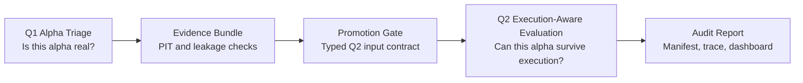

# PortfolioOS

PortfolioOS is an audit-ready evaluation platform for portfolio rebalance, scenario, approval, execution simulation, TCA, and research: it records whether a candidate alpha is real, and whether that alpha survives execution.

This is an auxiliary decision-support tool only. It does not constitute investment advice.

## Headline results

Two independent studies, backtest-based, no live trading.

The figures below are copied from the checked-in Week 1 baseline registry. They are external methodological benchmarks from a US WRDS workspace. They are not directly comparable to current-platform monthly factor runs, because they use different event timing, labels, and universes. They are not a production approval, and they are not evidence that a current-platform factor beat these benchmarks.

| Study | Recorded read | Why it is not a current-platform monthly comparator |
| --- | --- | --- |
| Announcement-timed `SUE` | Best clean window `[+2,+2]` with `rank_ic_t ~ 22.7`; best alpha-only t at `[+2,+3]` with `~12.3` | Event-driven label, announcement timing, WRDS-specific PIT workflow, different evaluation frame |
| Event-aware `revision_1m` | Pure `to-next-announcement` closeout at `rank_ic_t ~ 3.61`, `alpha_only_t ~ 4.03` | Event-aware label and full-panel event workflow, not the current fixed monthly factor grid |

Source: `docs/strategy/us_alpha_core_week1_baseline_registry_2026_04_16.md`.

The checked-in platform-native seed is `alt_momentum_4_1`. Its holdout metrics, the 40-date sample, and the development/holdout rank-IC sign flip are in `docs/phase_1_alpha_closeout_note.md`. That note reports the holdout mean rank-IC t-statistic as approximately 2.9 and treats the recipe as a provisional seed.

A-share `anti_mom_21_5` remains `background_partially_real` in Alpha Registry v2.

## Architecture



- Q1 validates schemas, timestamps, leakage risk, and planned tests. It lives under `projects/agentic_alpha_triage`.
- The evidence bundle records PIT-safe, leakage-checked research evidence.
- Promotion Gate can emit a typed Q2 input contract. It does not run Q2.
- Q2 asks whether the alpha survives execution and reports unavailable layers when PortfolioOS hooks are missing. It lives under `projects/execution_aware_optimizer`.
- Audit artifacts record what happened. Missing optimizer, liquidity, and risk hooks stay explicit rather than becoming synthetic numbers.

Track A is single-alpha research. Track B is multi-factor portfolio validation. Neither track enters Q2 directly or claims production approval. The boundary registry is `configs/research_tracks.yaml`.

## Quickstart

Requires Python 3.11+ and [Poetry](https://python-poetry.org/).

```bash
poetry install
make demo
make validate
```

`make demo` writes ignored local artifacts under `outputs/demo/`. `make validate` runs the no-network guard, example validation, report generation, and the focused regression tests wired in the `Makefile`.

## Reproduction

The headline WRDS statistics are registry records. This repository does not contain a one-command rerun of those external event studies.

Platform checks that do run here:

```bash
poetry install
make demo
make demo-v2
make validate
PYTHONDONTWRITEBYTECODE=1 poetry run pytest -q
```

`pytest` uses `tests/` from `pyproject.toml`. Tests marked `integration` skip unless Alpaca paper credentials are set. The longer command catalog, CLI examples, and case studies are in `docs/platform_manual.md` (the previous root README, moved without changing its research figures).

Phase 1 acceptance evidence is `docs/phase_1_alpha_closeout_note.md`. The 2026-04-15 paper-calibration read is `docs/paper_calibration_live_2026_04_15.md`.

## Limitations

- The default Q1/Q2 demo does not place orders, call a broker, or write live performance.
- The two headline studies are backtests from an external WRDS event workflow. They are not live trading results and not current-platform monthly factor scorecards.
- `alt_momentum_4_1` is a provisional seed. The Phase 1 closeout records a development/holdout rank-IC sign flip and a holdout t-statistic of approximately 2.9 on a short sample.
- Expanded SUE typed-Q2 evidence in this tree is a deterministic fixture (`event_count=120`, `rebalance_date_count=12`, `q2_observed_rows=30`). It does not prove historical SUE alpha. `no_view` stays abstain, not zero alpha.
- A-share `anti_mom_21_5` stays `background_partially_real` (`reports/alpha_registry_report.md`).
- Teaching-mode factor demos are survivorship-biased, educational-only, and not alpha evidence.
- The 2026-04-15 Alpaca paper calibration used strategy `neutral_buy_and_hold`, instrument `SPY`, and order size `1` share. Reconciliation was `matched_count = 12`, `mismatched_count = 0`. That run is one paper observation. It is not an alpha result and not live trading. The note says the sample is too small to describe partial fills or stress execution.

## Related components

Market-data replay is a separate component. This repository links it and does not vendor its code:

https://github.com/OrrinChen/market-replay

In-tree project shells: `projects/agentic_alpha_triage` (Q1), `projects/evidence_bundle`, `projects/promotion_gate`, `projects/execution_aware_optimizer` (Q2), `projects/audit_report`, `projects/typed_alpha_pilot`, and `projects/multifactor_alpha_validation`.
